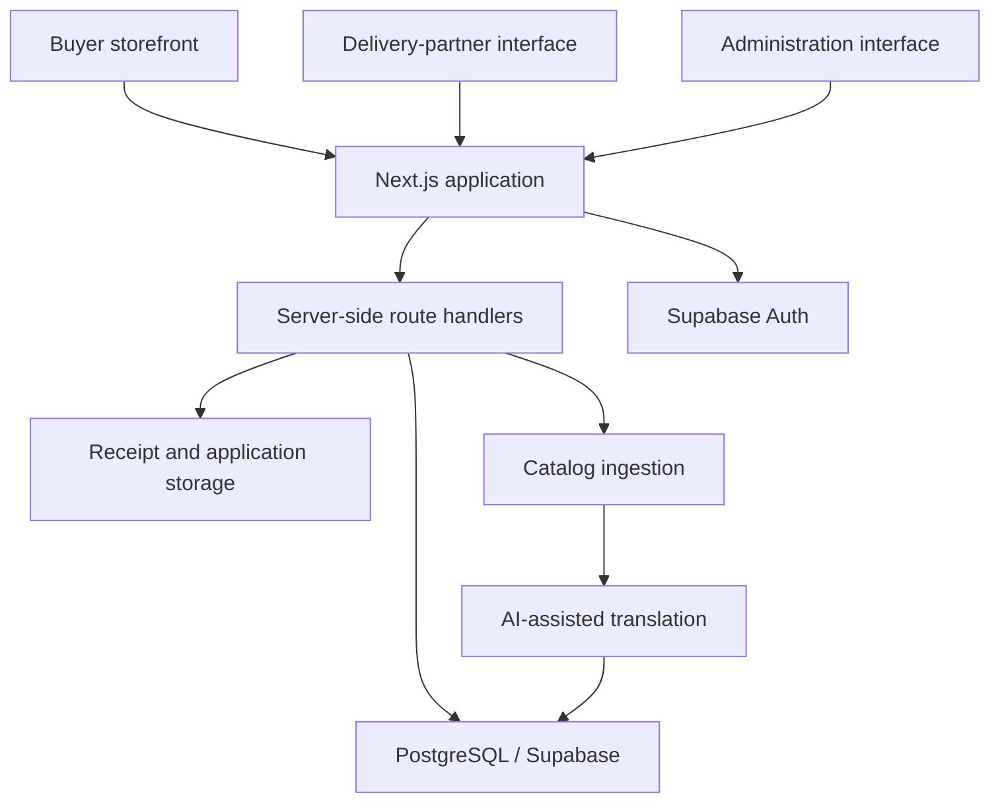

# GermanMarkt — full-stack marketplace case study

**Abdelrahman Salem · Full-stack web development · Germany / Egypt**

[Visit GermanMarkt](https://gm-egy.com) · [Developer profile](https://github.com/Salema0x)

GermanMarkt connects an Egyptian buyer storefront with delivery-partner and administration workflows. It brings catalog browsing, ordering, fulfillment coordination, and operational oversight into one web application.

This public case study describes the private **DM-Egypt** project. Application source, credentials, customer records, and commercial configuration remain private.

## The problem

An online storefront is only one part of a cross-border shopping workflow. Buyers need understandable product information and order updates; delivery partners need clear assignments; administrators need to manage availability and keep orders consistent when fulfillment changes.

The engineering challenge is keeping these different views aligned around shared data without giving every user the same permissions.

## Product workflows

| User | Main workflow |
| --- | --- |
| Buyer | Browse products, build a basket, place an order, and follow fulfillment progress |
| Delivery partner | View delivery work and manage assigned fulfillment activity |
| Administrator | Manage catalog and orders, organize delivery work, and inspect operational information |

The implementation includes multilingual product information and server-side AI-assisted translation. AI supports a specific catalog workflow rather than determining the application's core order state.

## Architecture

The application uses route groups to organize role-specific experiences. Shared components and TypeScript types connect the interfaces; server-side handlers support operational mutations. The backend uses PostgreSQL and Supabase, including row-level access policies. This describes the architecture, not an independent security certification.

## Technology choices

| Layer | Technologies |
| --- | --- |
| Web application | Next.js App Router, React, TypeScript |
| Interface styling | Tailwind CSS |
| Client state | TanStack Query for server data; Zustand for basket state |
| Backend and persistence | Next.js route handlers, Supabase, PostgreSQL |
| Catalog enrichment | Server-side OpenAI integration |
| Automated checks | Vitest, Playwright, GitHub Actions |

The current package manifest specifies Next.js 16 and React 19. Older internal documentation refers to earlier versions; the manifest is the basis for the stack described here.

## Engineering decisions and trade-offs

### One application for three roles

Keeping buyer, delivery, and admin interfaces in one application makes it easier to share types and UI components. The trade-off is that authorization must be enforced independently of which interface a user can navigate to.

### Separate basket state from server data

The basket is interactive client state, while catalog and order information come from the server. Using separate state mechanisms keeps these responsibilities explicit. Server-side validation remains necessary when a basket becomes an order.

### Model fulfillment changes explicitly

Product availability can change after an order is placed. The project includes an administrative item-removal workflow that recalculates affected order information and records the change for the buyer. This is a more useful engineering example than a checkout happy path alone: multiple views must remain consistent when the original order changes.

### Apply AI to a bounded task

Catalog translation is handled server-side and stored for reuse. This keeps the model integration focused on content enrichment while transactional workflows remain application and database responsibilities.

## Testing evidence

The private repository contains:

- **Vitest unit tests** for basket, catalog, formatting, profit calculations, order status, ticket priority, and TOTP utilities.
- **Playwright scenarios** covering buyer browsing and basket actions, search, order tracking, admin dashboards and ticket lists, and delivery views.
- **GitHub Actions configuration** with unit-test and end-to-end jobs.

The end-to-end job checks for required environment configuration and skips browser execution when it is missing. The presence of this workflow is therefore not evidence that every push ran the full browser suite.

This case study does not claim a current passing run, a coverage percentage, a security audit, or measured production performance.

## Current scope and further work

The project demonstrates a full-stack implementation spanning customer-facing UI, operational interfaces, persistent data, and external-service integration.

Further work identified in the project documentation includes fuller refund/dispute handling and proactive buyer notifications. Operational outcomes such as user counts, revenue, conversion rates, and time saved are not published here because verified measurements have not been supplied.

**Source availability:** GermanMarkt is a private commercial project. This case study describes its architecture and selected implementation details without exposing application source or customer data.
